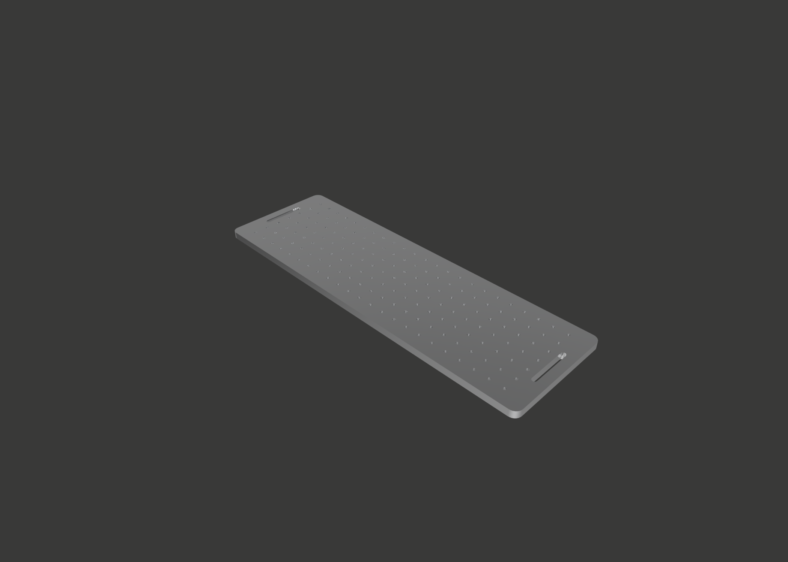
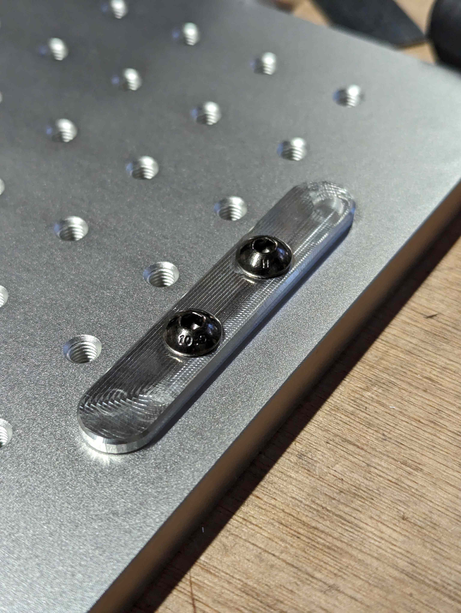

# F.I.X.A.T.E.D - The Millennium Machines Fixturing System

Welcome to the Millennium Machines F.I.X.A.T.E.D project. Fixated is a list of fixtures and parts created for the Milo V1.5 line of machines.

## Fixture plates

### The Full Monty

A fixture plate system designed to fit the bed of a standard-sized Milo V1.5 (500x160mm), featuring hole spacings of 20mm on center intended for tapping to M5, and another set of holes also 20mm on center to accommodate 6mm dowel pins.

### The Full Monty (SLIM)

The Full Monty Slim covers the same features as the regular Full Monty, but its holes only cover the workable area of a standard Milo V1.5.

### The Continental Breakfast

The Full Monty's slim European cousin, this fixture plate system is designed to fit the bed of a standard-sized Milo V1.5 (500x160mm), and features hole spacings of 20mm on center intended for tapping to M5. Unlike the Full Monty, it does not include the holes for 6mm dowel pins.

### The Continental Breakfast (SLIM)

The Continental Breakfast slim covers the same features as the regular Continental Breakfast, but its holes only cover the workable area of a standard Milo V1.5.

For manufacturing specifications and tolerances, please see the [documentation](docs/README.md).

## Plate clamps

The best way to hold your Fixated plate down is with these plate clamps. They can be 3D printed, but for the best performance you will want to machine a set.

For manufacturing specifications and technical drawings, please see the [documentation](docs/Machined%20plate%20clamps/README.md).
